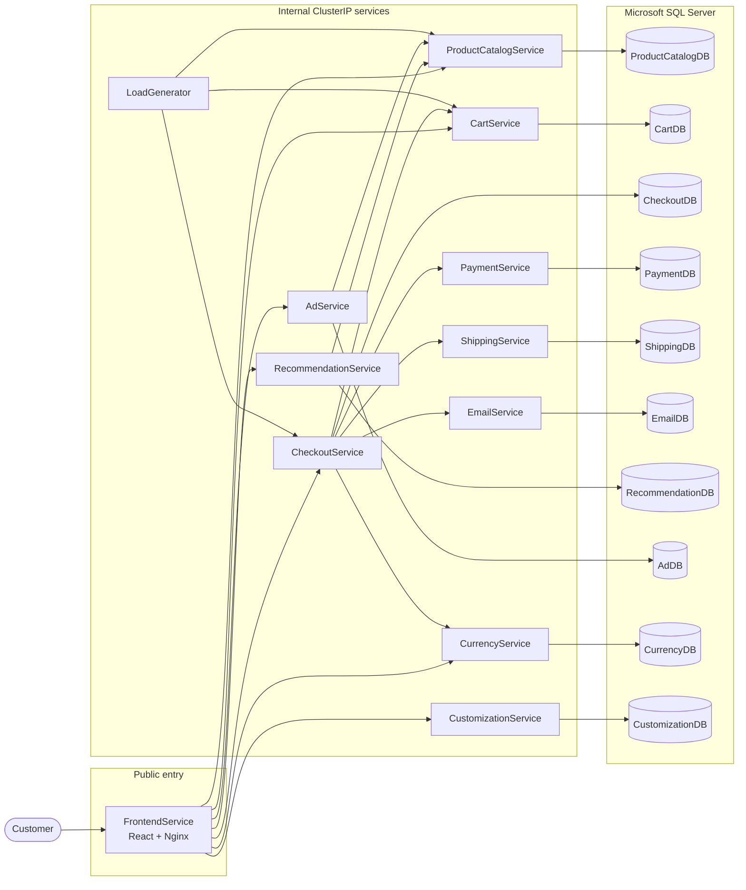

# DiSaMart Architecture

## Goals

- Independently build, run, test, and deploy 12 microservices.
- Keep frontend and backend ownership separate.
- Use REST APIs for synchronous communication.
- Use SQL Server with one database or isolated schema per service.
- Avoid sharing EF Core entities or database connections across services.
- Expose only the frontend publicly.

## Logical Architecture



## Service Responsibilities

| Service | Responsibility | Database |
|---|---|---|
| AdService | Ads and campaigns | AdDB |
| CartService | User carts and quantities | CartDB |
| CheckoutService | Order orchestration | CheckoutDB |
| CurrencyService | Static conversion rates | CurrencyDB |
| EmailService | Mock email templates and logs | EmailDB |
| CustomizationService | Themes and user preferences | CustomizationDB |
| LoadGenerator | HTTP traffic simulation | None |
| PaymentService | Mock payment processing | PaymentDB |
| ProductCatalogService | Categories, products, search | ProductCatalogDB |
| RecommendationService | Static recommendations | RecommendationDB |
| ShippingService | Addresses and shipment records | ShippingDB |
| FrontendService | React UI and Nginx hosting | None |

## Communication Rules

- Browser calls only the frontend origin. Nginx routes `/api/*` to backend services.
- Backend calls use Kubernetes DNS names such as `http://cartservice:8080`.
- Each HTTP call is timeout bounded and uses a retry policy only for transient network failures.
- Checkout is the orchestrator and uses the other services without directly sharing their databases.
- Events and durable messaging are not required in the initial implementation.

## Checkout Flow

1. Frontend submits a checkout request with a user ID and cart ID.
2. CheckoutService requests cart details from CartService.
3. CheckoutService validates the cart and requests a total conversion from CurrencyService when needed.
4. CheckoutService requests payment simulation from PaymentService.
5. On payment success, CheckoutService requests shipment creation from ShippingService.
6. CheckoutService creates the order and requests an order email from EmailService.
7. CheckoutService clears the cart through CartService.
8. CheckoutService returns a stable order confirmation response.

Failure handling must use compensating behavior: payment failures create no shipment or confirmation email, and partial order failures return a typed error.

## Health and Observability

- Every HTTP service exposes `GET /health/live` and `GET /health/ready`.
- Services use structured console logging.
- Service DNS, environment variables, and connection strings are injected by Compose or Kubernetes.
- No service exposes SQL Server or a secret port outside the Docker/Kubernetes network.

## Security and Configuration

- JWT settings are configured through environment variables.
- Development secrets are supplied through `.env.example` only.
- SQL Server passwords are never committed.
- Kubernetes Secrets store database and JWT values.
- ConfigMaps store public URLs and non-sensitive settings.

## Service Project Convention

Each .NET service will use the same minimal structure:

```text
src/
  DiSaMart.<Name>.Api/
    Controllers/
    DTOs/
    Models/
    Data/
    Services/
    Program.cs
  DiSaMart.<Name>.Api.Tests/
Dockerfile
```
